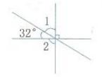

# Mathematics (Grade 3)

**ID**: 6d229f9b
**难度**: medium
**题型**: fill_in_the_blank

## 题目
下图中，∠1＝(    )°，∠2＝(    )°

 1,32°,2

## 解答

**答案**: 58, 90

1. Step1:根据已知条件，因为∠1加上32°等于一个直角，直角为90°，所以计算∠1的度数，即∠1 = 90° - 32° = 58°
2. Step2:因为∠2是右上角直角的对顶角，根据对顶角相等，直角为90°，所以∠2 = 90°

## 知识点

**知识点**:
  - 图形的认识 测量;

---
