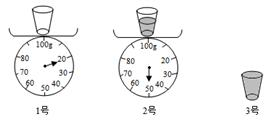

# Mathematics (Grade 3)

**ID**: 76d60cda
**难度**: medium
**题型**: fill_in_the_blank

## 题目
读图填一填。

（1）1号杯重（____）克。（2）2号杯中的水重（___）克。
（3）估一估，3号杯中的水大约重（___）克，这时如果将3号杯放到台秤上，台秤指针所指的重量大约是（____）克。

## 解答

**答案**: 20, 50, 100, 100

1. Step1:观察图片可知，1号杯为空杯，台秤指针指向20，所以1号杯重20克
2. Step2:2号杯中有水，台秤指针指向70，用2号杯和水的总重70克减去1号杯的重量20克，可得2号杯中的水重70 - 20 = 50克
3. Step3:观察发现2号杯中的水大约占杯子的一半，3号杯中的水接近满杯，所以3号杯中的水大约是2号杯中的水的2倍，即50×2 = 100克
4. Step4:3号杯的重量是20克，3号杯中的水大约重100克，将3号杯放到台秤上，台秤指针所指的重量大约是杯子和水的总重，即20 + 100 = 100克

## 知识点

**知识点**:
  - 小学数学;数与代数;常见的量;质量单位及换算;质量单位的换算

---
