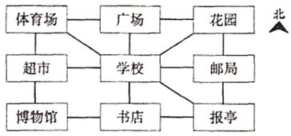

# Mathematics (Grade 3)

**ID**: 824617cd
**难度**: medium
**题型**: fill_in_the_blank

## 题目

（1）超市在学校的________面，报亭在邮局的________面。   
（2）花园在学校的________方向，体育场在学校的________方向。

## 解答

**答案**: 西, 南, 东北, 西北

1. Step1:根据地图方向标识，上北下南左西右东，观察超市与学校的位置关系，超市在学校的左边，所以超市在学校的西面。
2. Step2:观察报亭与邮局的位置关系，报亭在邮局的下面，所以报亭在邮局的南面。
3. Step3:观察花园与学校的位置关系，花园在学校的右上方，右上方即东北方向，所以花园在学校的东北方向。
4. Step4:观察体育场与学校的位置关系，体育场在学校的左上方，左上方即西北方向，所以体育场在学校的西北方向。

## 知识点

**知识点**:
  - 

---
