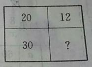

# Mathematics (Grade 3)

**ID**: 831d1232
**难度**: medium
**题型**: fill_in_the_blank

## 题目
下面的大长方形被分成了四个小长方形，其中三个小长方形的面积分别为20平方厘米、30平方厘米、12平方厘米，第四个小长方形的面积是多少平方厘米？

## 解答

**答案**: 18

1. Step1:观察发现，面积为20平方厘米和30平方厘米的小长方形的长在同一条直线上，它们的长相等，设为a；面积为12平方厘米和所求面积的小长方形的长也在同一条直线上，它们的长也相等，设为b。
2. Step2:面积为20平方厘米和12平方厘米的小长方形的宽在同一条直线上，它们的宽相等，设为c；面积为30平方厘米和所求面积的小长方形的宽也在同一条直线上，它们的宽也相等，设为d。
3. Step3:由长方形面积公式S=长×宽，可得20 = a×c，30 = a×d，12 = b×c，设第四个小长方形面积为S，则S = b×d。
4. Step4:因为20 = a×c，30 = a×d，所以d/c = 30/20；又因为12 = b×c，S = b×d，所以S/12 = d/c。
5. Step5:由d/c = 30/20和S/12 = d/c，可得S/12 = 30/20。
6. Step6:求解S，S = 30×12÷20 = 360÷20 = 18平方厘米。

## 知识点

**知识点**:
  - 

---
