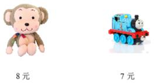

# Mathematics (Grade 3)

**ID**: 83f5de84
**难度**: medium
**题型**: fill_in_the_blank

## 题目
小华有16块钱，请你列算式解答下面问题。

（1）买一个玩具猴还剩下多少钱？
□○□=□（元）
（2）买一个玩具火车和玩具猴还剩下多少钱？
□○□○□=□（元）

## 解答

**答案**: 8, 1

1. Step1:对于问题（1），已知小华有16块钱，玩具猴8元，用总钱数减去买玩具猴花的钱就是剩下的钱，算式为16 - 8 = 8元
2. Step2:对于问题（2），已知小华有16块钱，玩具猴8元，玩具火车7元，先算出买玩具猴后剩下的钱为16 - 8 = 8元，再用剩下的8元减去买玩具火车花的7元，即8 - 7 = 1元，综合算式为16 - 8 - 7 = 1元

## 知识点

**知识点**:
  - 小学数学;数与代数;应用题;简单应用题;整数简单应用题

---
