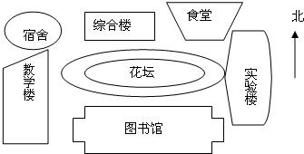

# Mathematics (Grade 3)

**ID**: 87861d0a
**难度**: medium
**题型**: fill_in_the_blank

## 题目
看图填空．某小学的校园平面图的一部分．食堂在花坛的(    )面；教学楼在实验楼的(    )面；花坛的南面是(    )．

## 解答

**答案**: 东北, 西, 图书馆

1. Step1:根据上北下南，左西右东的方位辨别方法，观察图中食堂在花坛的右上方，右上方即东（右）北（上）面，所以食堂在花坛的东北面
2. Step2:依据上北下南，左西右东，看到教学楼在实验楼的左边，左边即西（左）面，所以教学楼在实验楼的西面
3. Step3:按照上北下南，左西右东，花坛的南面即下面，图中花坛下面是图书馆，所以花坛的南面是图书馆

## 知识点

**知识点**:
  - 方向．

---
