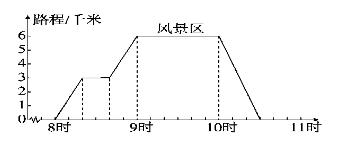

# Mathematics (Grade 3)

**ID**: 8beb29b6
**难度**: medium
**题型**: fill_in_the_blank

## 题目
下图是小辉周末郊游情况统计图。

(1)他（____）时从家出发的；
(2)他在路上休息了（____）分钟；
(3)他家距离风景区（____）千米；
(4)他在风景区玩了（____）小时；
(5)他回家用了（____）分钟。

## 解答

**答案**: 8, 20, 6, 1, 30

1. Step1:观察统计图，横坐标为时间，起始时间对应的是出发时间，可知他8时从家出发，对应答案第一个空为8
2. Step2:路程不变的时间段为休息时间，8时到8时20分路程不变，所以在路上休息了20分钟，对应答案第二个空为20
3. Step3:统计图中最终到达的路程即为家到风景区的距离，可知他家距离风景区6千米，对应答案第三个空为6
4. Step4:在风景区时路程不变，9时到达风景区，10时离开，10 - 9 = 1，所以在风景区玩了1小时，对应答案第四个空为1
5. Step5:10时开始回家，10时30分到家，10时30分 - 10时 = 30分钟，所以回家用了30分钟，对应答案第五个空为30

## 知识点

**知识点**:
  - 小学数学;统计和概率;统计;统计图表的综合应用

---
