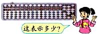

# Mathematics (Grade 3)

**ID**: 8c193828
**难度**: medium
**题型**: fill_in_the_blank

## 题目
算盘上珠子表示的数是$\underline{\hspace{5em}}$．

## 解答

**答案**: 682

1. Step1:明确算盘的计数规则，上面的每个珠子代表5，下面的每个珠子代表1
2. Step2:从算盘的个位开始观察，个位档下有2个珠子，代表2
3. Step3:观察十位档，下有3个珠子，上有1个珠子，3×1 + 5 = 8，代表8
4. Step4:观察百位档，上有1个珠子，下有1个珠子，5 + 1 = 6，代表6
5. Step5:将百位、十位、个位代表的数字组合起来，得到682

## 知识点

**知识点**:
  - 计算器与复杂的运算；整数的认识．

---
