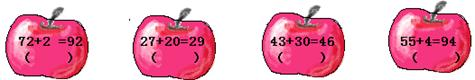

# Mathematics (Grade 3)

**ID**: 8cba3be9
**难度**: medium
**题型**: fill_in_the_blank

## 题目
下面计算有无错误，有，请改正。

改正：_____    改正：_____    改正：______    改正：_____

## 解答

**答案**: 74, 47, 73, 59

1. Step1:计算72+2，个位2+2=4，十位是7，结果为74
2. Step2:计算27+20，个位不变为7，十位2+2=4，结果为47
3. Step3:计算43+30，个位不变为3，十位4+3=7，结果为73
4. Step4:计算55+4，个位5+4=9，十位是5，结果为59

## 知识点

**知识点**:
  - 小学数学;数与代数;数的运算;口算;整数的口算与估算

---
