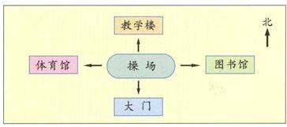

# Mathematics (Grade 3)

**ID**: 94519594
**难度**: medium
**题型**: fill_in_the_blank

## 题目

图书馆在操场的$\underline{\hspace{5em}}$面．

## 解答

**答案**: 东

1. Step1:明确平面图方向标规则为上北、下南、左西、右东
2. Step2:观察图中图书馆与操场的位置关系
3. Step3:根据方向标，判断出图书馆在操场的右边
4. Step4:依据方向标规则，右边对应的方向是东，得出图书馆在操场的东面

## 知识点

**知识点**:
  - 方向．

---
