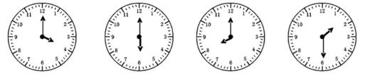

# Mathematics (Grade 3)

**ID**: 98362e2a
**难度**: medium
**题型**: fill_in_the_blank

## 题目
写出相应的时间。

__时              __时             __时         __时__分

## 解答

**答案**: 4, 6, 8, 1, 30

1. Step1:观察第一个时钟，时针指向4，分针指向12，所以对应的时间是4时
2. Step2:观察第二个时钟，时针指向6，分针指向12，所以对应的时间是6时
3. Step3:观察第三个时钟，时针指向8，分针指向12，所以对应的时间是8时
4. Step4:观察第四个时钟，时针指向1和2之间靠近1，分针指向6，因为分针每走一大格代表5分钟，分针指向6代表走了6个大格，5×6 = 30分钟，所以对应的时间是1时30分
5. Step5:按照题目顺序依次提取4、6、8、1、30

## 知识点

**知识点**:
  - 小学数学;数与代数;常见的量;时间单位及换算;认识钟面指针及时间读法

---
