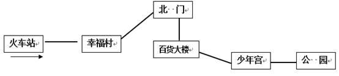

# Mathematics (Grade 3)

**ID**: 9bf516b6
**难度**: medium
**题型**: fill_in_the_blank

## 题目
下面是21路公共汽车的行车路线图．

21路从火车站到百货大楼，要先向（_______）到幸福村，再向（_______）到北门，最后向（_______）到百货大楼．
从公园到百货大楼，要先向（_______）到（_______），再向（_______）到（_______）．

## 解答

**答案**: 东, 东北, 南, 西, 少年宫, 西北, 百货大楼

1. Step1:观察21路公共汽车从火车站到幸福村的路线方向，根据图中箭头指向，判断是向东
2. Step2:观察从幸福村到北门的路线方向，根据方向判断是向东北
3. Step3:观察从北门到百货大楼的路线方向，根据方向判断是向南
4. Step4:观察从公园到百货大楼的路线，先判断从公园到少年宫的方向，根据图中箭头指向，确定是向西
5. Step5:明确从公园到百货大楼的路线中，先到达的地点是少年宫
6. Step6:判断从少年宫到百货大楼的方向，根据方向判断是向西北
7. Step7:明确从少年宫到百货大楼路线中，后到达的地点是百货大楼

## 知识点

**知识点**:
  - 

---
