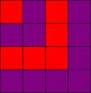

# Mathematics (Grade 3)

**ID**: 9f6fd2bc
**难度**: medium
**题型**: fill_in_the_blank

## 题目
计算:1+3+5+7+9+11+13的值

## 解答

**答案**: 49

1. Step1:观察解析2，发现从1开始连续奇数相加的和等于数的个数的平方
2. Step2:数1+3+5+7+9+11+13中奇数的个数，一共有7个
3. Step3:根据发现的规律，7个连续奇数相加的和等于7的平方
4. Step4:计算7的平方，7×7 = 49

## 知识点

**知识点**:
  - 小学数学;探索规律;图形的变化规律

---
