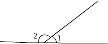

# Mathematics (Grade 3)

**ID**: aa0c9dca
**难度**: medium
**题型**: fill_in_the_blank

## 题目
已知∠1=63°，求∠2．

## 解答

**答案**: 117

1. Step1:明确平角的度数为180°
2. Step2:观察图形得出∠1和∠2构成平角
3. Step3:根据平角性质可知∠2 = 180° - ∠1
4. Step4:已知∠1 = 63°，将其代入∠2 = 180° - ∠1，得到∠2 = 180° - 63°
5. Step5:计算180° - 63°的结果为117°，即∠2的度数为117°

## 知识点

**知识点**:
  - 线段与角的综合

---
