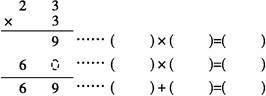

# Mathematics (Grade 3)

**ID**: b5e21d68
**难度**: medium
**题型**: fill_in_the_blank

## 题目
想一想,填一填。
方法一:口算23×3=□
想:□×3=□
□×3=□
60+□=□
方法二:用竖式计算

## 解答

**答案**: 69, 20, 60, 3, 9, 9, 69

1. Step1:计算23×3的结果为69
2. Step2:将23拆分为20和3
3. Step3:计算20×3=60
4. Step4:计算3×3=9
5. Step5:得出60 + 9 = 69

## 知识点

**知识点**:
  - 

---
