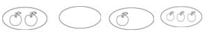

# Mathematics (Grade 3)

**ID**: b75b4b37
**难度**: medium
**题型**: fill_in_the_blank

## 题目
在（    ）里填数。

（1）从左边数，第一个盘子里放了（______）个苹果。
（2）从右边数，第（______）个盘子里放了3个苹果，它左边的盘子里有（_______）个苹果。

## 解答

**答案**: 2, 一, 1

1. Step1:观察图片，从左边数，第一个盘子里有2个苹果，所以（1）的答案是2
2. Step2:从右边数，第一个盘子里有3个苹果，所以从右边数，第一个盘子符合放了3个苹果的条件，故（2）中第一个空答案是一
3. Step3:从右边数放了3个苹果的盘子（即第一个盘子），它左边的盘子（即第二个盘子）里有1个苹果，所以（2）中第二个空答案是1

## 知识点

**知识点**:
  - 小学数学;数与代数;数的认识;整数的认识;图形与几何;位置与方向;位置

---
