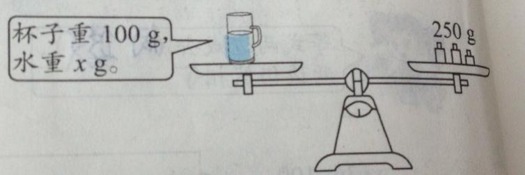

# Mathematics (Grade 3)

**ID**: b831db18
**难度**: medium
**题型**: fill_in_the_blank

## 题目
杯子重100克，水重x克.总重量250克.求水的重量？

## 解答

**答案**: 150

1. Step1:根据题目可知杯子重量加上水的重量等于总重量，可列出方程100 + x = 250
2. Step2:根据等式的性质，等式两边同时减去100，即100 + x - 100 = 250 - 100
3. Step3:计算得出x = 150，所以水重150克

## 知识点

**知识点**:
  - --

---
