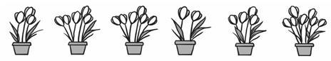

# Mathematics (Grade 3)

**ID**: b9beb115
**难度**: medium
**题型**: fill_in_the_blank

## 题目

(1)第一盆有3朵花，第三盆有（______）朵花。
(2)从左数，有4朵花的是第（______）盆，它左边的一盆有（______）朵花，右边的一盆有（______）朵花。

## 解答

**答案**: 6, 5, 2, 7

1. Step1:观察图片可知，从左往右数，第一盆有3朵花，第三盆有6朵花，所以第一个空填6
2. Step2:继续观察图片，从左数，有4朵花的是第5盆
3. Step3:第5盆左边的一盆是第4盆，第4盆有2朵花，所以第三个空填2
4. Step4:第5盆右边的一盆是第6盆，第6盆有7朵花，所以第四个空填7

## 知识点

**知识点**:
  - 

---
