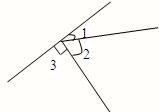

# Mathematics (Grade 3)

**ID**: bd22a100
**难度**: medium
**题型**: fill_in_the_blank

## 题目
∠1=30°，∠2=______°，∠3=______°，∠2+∠3=______°．

## 解答

**答案**: 60, 90, 150

1. Step1:根据图意可知∠3是直角，直角为90°，所以∠3 = 90°
2. Step2:已知∠1 = 30°，且∠1和∠2组成直角，直角为90°，所以∠2 = 90° - 30° = 60°
3. Step3:已求得∠2 = 60°，∠3 = 90°，所以∠2 + ∠3 = 60° + 90° = 150°

## 知识点

**知识点**:
  - 角的概念及其分类．

---
