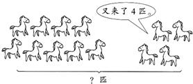

# Mathematics (Grade 3)

**ID**: bfe76a2f
**难度**: medium
**题型**: fill_in_the_blank

## 题目
看图写算式

______○______=______(匹)

## 解答

**答案**: 9, +, 4, 13

1. Step1:观察图片可知，原来有9匹马
2. Step2:明确题目告知又来了4匹马
3. Step3:根据数量关系，求总数量需将原来的9匹马和又来的4匹马相加
4. Step4:计算得出9 + 4 = 13，所以算式中的数字分别为9、4、13，运算符号为+

## 知识点

**知识点**:
  - 图文应用题;整数的加法和减法．

---
