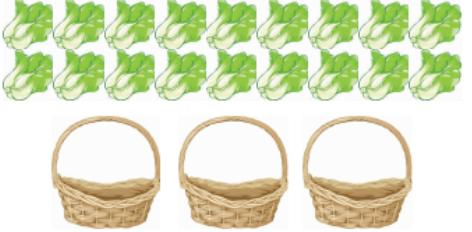

# Mathematics (Grade 3)

**ID**: d00be92a
**难度**: medium
**题型**: fill_in_the_blank

## 题目

18棵白菜，平均装在3个篮子里，每个篮子里装几棵？

## 解答

**答案**: 6

1. Step1:明确题目是要将18棵白菜平均分配到3个篮子里
2. Step2:根据除法的意义，求每个篮子装几棵，就是把18平均分成3份，求每份是多少，用除法计算
3. Step3:列出除法算式18÷3
4. Step4:利用表内除法口诀，计算得出18÷3 = 6

## 知识点

**知识点**:
  - 用口诀求商

---
