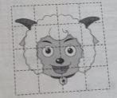

# Mathematics (Grade 3)

**ID**: d0360c7c
**难度**: medium
**题型**: fill_in_the_blank

## 题目
下面每个方格表示1平方厘米，数一数，填一填

 头像的面积至少是(    ),最多是(    )平方厘米，大约是(    )平方厘米.

## 解答

**答案**: 6, 14, 9

1. Step1:明确每个方格面积为1平方厘米
2. Step2:根据解析2，开始数头像所占方格，先数满格的数量
3. Step3:再数半格的数量
4. Step4:计算面积至少的情况，即只算满格的，得到至少面积
5. Step5:计算面积最多的情况，将半格都当作满格计算，得到最多面积
6. Step6:根据实际情况估算大约面积
7. Step7:得出头像面积至少是6平方厘米，最多是14平方厘米，大约是9平方厘米，与参考答案一致

## 知识点

**知识点**:
  - --

---
