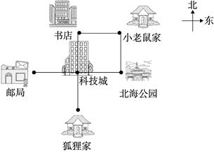

# Mathematics (Grade 3)

**ID**: d4897de8
**难度**: medium
**题型**: fill_in_the_blank

## 题目
辨认方向。

（1）小老鼠家在书店的______面，在北海公园的______面。
（2）邮局在科技城的______面，北海公园在狐狸家的______面。

## 解答

**答案**: 东, 北, 西, 东北

1. Step1:根据“上北下南，左西右东”的方向辨别方法，观察图可知小老鼠家在书店的右边，所以小老鼠家在书店的东面
2. Step2:小老鼠家在北海公园的上面，所以小老鼠家在北海公园的北面
3. Step3:邮局在科技城的左边，所以邮局在科技城的西面
4. Step4:北海公园在狐狸家的右上方，所以北海公园在狐狸家的东北面

## 知识点

**知识点**:
  - 小学数学;图形与几何;位置与方向;方向

---
