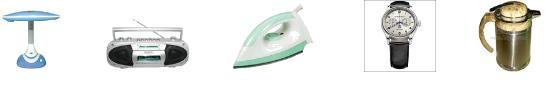

# Mathematics (Grade 3)

**ID**: e2a99628
**难度**: medium
**题型**: fill_in_the_blank

## 题目
看图填一填。

195元        404元         302元           298元          96元
①买台灯和手表大约（_______）元   
② 买录音机和电熨斗大约（______）元
③买保温壶和台灯大约（______）元  
④ 买录音机和手表大约（________）元

## 解答

**答案**: 500, 700, 300, 700

1. Step1:台灯价格195元，可近似看作200元；手表价格298元，可近似看作300元，200 + 300 = 500元，所以买台灯和手表大约500元
2. Step2:录音机价格404元，可近似看作400元；电熨斗价格302元，可近似看作300元，400 + 300 = 700元，所以买录音机和电熨斗大约700元
3. Step3:保温壶价格96元，可近似看作100元；台灯价格195元，可近似看作200元，100 + 200 = 300元，所以买保温壶和台灯大约300元
4. Step4:录音机价格404元，可近似看作400元；手表价格298元，可近似看作300元，400 + 300 = 700元，所以买录音机和手表大约700元

## 知识点

**知识点**:
  - 

---
