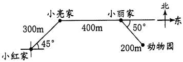

# Mathematics (Grade 3)

**ID**: e2d58dbd
**难度**: medium
**题型**: fill_in_the_blank

## 题目
请你将小红去动物园的行走路线补充完整．

从图中，我们可以知道：小红从家出发先向_____方向走_____m到小亮家，和小亮一起向东走400m到小丽家，然后三人一起向_____方向走_____m到动物园．

## 解答

**答案**: 东偏北45°, 300, 东偏南50°, 200

1. Step1:观察图中方向标，明确上北下南左西右东的方向规则
2. Step2:从小红家到小亮家，根据图中角度和距离信息，可知方向为东偏北45°，距离是300m
3. Step3:从小丽家到动物园，根据图中角度和距离信息，可知方向为东偏南50°，距离是200m

## 知识点

**知识点**:
  - 

---
