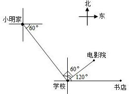

# Mathematics (Grade 3)

**ID**: e34905ea
**难度**: medium
**题型**: fill_in_the_blank

## 题目
填一填．

（1）小明家在学校的（______）偏（______）（______）°方向．
（2）电影院在学校的（______）偏（______）（______）°方向．

## 解答

**答案**: 北, 西, 30°, 北, 东, 60°

1. Step1:确定小明家相对于学校的方向，以学校为观测点，根据图中角度可知小明家在学校的北偏西方向，角度为30°
2. Step2:确定电影院相对于学校的方向，以学校为观测点，根据图中角度可知电影院在学校的北偏东方向，角度为60°
3. Step3:整理答案，将小明家方向的三个信息和电影院方向的三个信息依次列出，即北、西、30°、北、东、60°

## 知识点

**知识点**:
  - 

---
