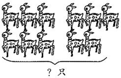

# Mathematics (Grade 3)

**ID**: e6187981
**难度**: medium
**题型**: fill_in_the_blank

## 题目
我会看图列算式．

6+$\underline{\hspace{5em}}$=$\underline{\hspace{5em}}$．

## 解答

**答案**: 5, 11

1. Step1:观察图片可知，左边有6只小鹿
2. Step2:观察图片可知，右边有5只小鹿
3. Step3:求小鹿的总数，就是将左边的6只和右边的5只合起来，用加法计算，即6 + 5
4. Step4:计算6 + 5的结果为11

## 知识点

**知识点**:
  - 图文应用题；整数的加法和减法．

---
