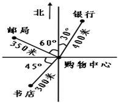

# Mathematics (Grade 3)

**ID**: e623091a
**难度**: medium
**题型**: fill_in_the_blank

## 题目
以购物中心为观测点。

(1)银行的位置是北偏东______方向，距离购物中心_______米。
(2)书店的位置是_______偏______方向，距离购物中心________米。
(3) _______在北偏西60°方向。

## 解答

**答案**: 30°, 400, 南, 西, 300, 邮局

1. Step1:根据图中信息，以购物中心为观测点，银行在北偏东方向，其角度为30°，距离为400米，所以第一个空填30°，第二个空填400
2. Step2:书店在购物中心的南偏西方向，距离为300米，所以第三、四个空分别填南、西，第五个空填300
3. Step3:从图中可知在北偏西60°方向的是邮局，所以第六个空填邮局

## 知识点

**知识点**:
  - 小学数学;图形与几何;位置与方向;位置;方向

---
