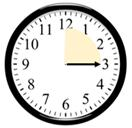

# Mathematics (Grade 3)

**ID**: e680730b
**难度**: medium
**题型**: fill_in_the_blank

## 题目
分针从12旋转到3，经过了（  ）分钟，所经过的区域占整个钟面的$\frac{\left( {} \right)}{\left( {} \right)}$。

## 解答

**答案**: 15, 1, 4

1. Step1:钟面上分针走一大格是5分钟，从12旋转到3走了3大格，5×3 = 15，所以经过了15分钟
2. Step2:钟面被平均分成12大格，分针从12旋转到3走了3大格，3÷12 = $\frac{1}{4}$，所以所经过的区域占整个钟面的$\frac{1}{4}$
3. Step3:将经过的分钟数15作为答案的第一个元素，将$\frac{1}{4}$的分子1作为答案的第二个元素，分母4作为答案的第三个元素，得到['15', '1', '4']

## 知识点

**知识点**:
  - 

---
