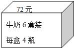

# Mathematics (Grade 3)

**ID**: e7fc27aa
**难度**: medium
**题型**: fill_in_the_blank

## 题目
每瓶牛奶多少钱？

## 解答

**答案**: 3

1. Step1:根据已知条件，牛奶是6盒装，每盒4瓶，根据乘法的意义，用6×4计算出这箱牛奶的总瓶数为24瓶
2. Step2:已知这箱牛奶总价是72元，由单价=总价÷数量，这里的数量是总瓶数24瓶，总价是72元，所以用72÷24计算每瓶牛奶的价格
3. Step3:计算72÷24的结果为3元，即每瓶牛奶3元

## 知识点

**知识点**:
  - 图文应用题．

---
