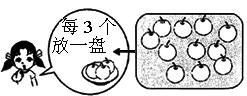

# Mathematics (Grade 3)

**ID**: ef0fed52
**难度**: medium
**题型**: fill_in_the_blank

## 题目
看图填空． 

可以放________盘，还剩________个．
算式：________÷________=________……________

## 解答

**答案**: 3, 2, 11, 3, 3, 2

1. Step1:观察图片可知一共有11个苹果
2. Step2:题目告知每3个放一盘
3. Step3:用苹果总数11除以每盘放的个数3，即11÷3
4. Step4:计算11÷3的商为3，这就是可以放的盘数
5. Step5:计算11÷3的余数为2，这就是剩余的苹果个数
6. Step6:得出答案依次为可以放3盘，还剩2个，算式为11÷3 = 3……2

## 知识点

**知识点**:
  - 小学数学;数与代数;应用题;常见的数学问题;图文问题

---
