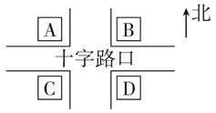

# Mathematics (Grade 3)

**ID**: f31ed035
**难度**: medium
**题型**: fill_in_the_blank

## 题目
看图填空。

B在十字路口的（____）面，C在十字路口的（____）面；B在A的（____）面，B在D的（____）面，（____）在A的东南面，（____）在C的东北面。

## 解答

**答案**: 东北, 西南, 东, 北, D, B

1. Step1:根据图中上方标有'北'，可知遵循上北下南，左西右东的方向规则。
2. Step2:判断B在十字路口的方向，B在十字路口的右上方，根据方向规则，右上方为东北方向，所以B在十字路口的东北面。
3. Step3:判断C在十字路口的方向，C在十字路口的左下方，左下方为西南方向，所以C在十字路口的西南面。
4. Step4:判断B在A的方向，以A为观测点，B在A的右边，右边为东，所以B在A的东面。
5. Step5:判断B在D的方向，以D为观测点，B在D的上方，上方为北，所以B在D的北面。
6. Step6:判断在A的东南面的位置，A的东南面即A的右下方，图中D在A的右下方，所以D在A的东南面。
7. Step7:判断在C的东北面的位置，C的东北面即C的右上方，图中B在C的右上方，所以B在C的东北面。

## 知识点

**知识点**:
  - 小学数学;图形与几何;位置与方向;方向

---
