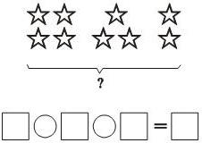

# Mathematics (Grade 3)

**ID**: f6836858
**难度**: medium
**题型**: fill_in_the_blank

## 题目
看图列式计算．

## 解答

**答案**: 4+3+2=9

1. Step1:观察图片，确定左边星星的数量为4个
2. Step2:观察图片，确定中间星星的数量为3个
3. Step3:观察图片，确定右边星星的数量为2个
4. Step4:根据题意，求星星总数需将三部分星星数量相加，列出算式4+3+2
5. Step5:计算4+3+2的结果为9，得出最终算式4+3+2=9

## 知识点

**知识点**:
  - 整数的加法和减法．

---
