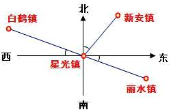

# Mathematics (Grade 3)

**ID**: fda6b241
**难度**: medium
**题型**: fill_in_the_blank

## 题目
量一量，图上1cm表示实际10km．
（1）新安镇在星光镇北偏东40°_____km处．
（2）白鹤镇在星光镇_____偏_____km处．
（3）丽水镇在星光镇_____偏_____km处．

## 解答

**答案**: 25, 西, 北20°35, 东, 南20°30

1. Step1:根据题目中图上1cm表示实际10km，量得新安镇到星光镇的图上距离为2.5cm，所以实际距离为2.5×10 = 25km，得出新安镇在星光镇北偏东40°25km处
2. Step2:量得白鹤镇到星光镇的图上距离为3.5cm，实际距离为3.5×10 = 35km，根据图上位置可知白鹤镇在星光镇西偏北20°35km处
3. Step3:量得丽水镇到星光镇的图上距离为3cm，实际距离为3×10 = 30km，根据图上位置可知丽水镇在星光镇东偏南20°30km处

## 知识点

**知识点**:
  - 

---
