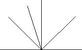

# Mathematics (Grade 3)

**ID**: 02483819
**难度**: medium_hard
**题型**: fill_in_the_blank

## 题目
如图，其中共有 $\underline{\hspace{5em}}$ 个锐角， $\underline{\hspace{5em}}$ 直角， $\underline{\hspace{5em}}$ 个钝角．

## 解答

**答案**: 8, 3, 3

1. Step1:明确锐角是大于0度小于90度的角，直角是等于90度的角，钝角是大于90度小于180度的角
2. Step2:观察图中角，逐一判断并统计锐角的数量，得到锐角有8个
3. Step3:观察图中角，逐一判断并统计直角的数量，得到直角有3个
4. Step4:观察图中角，逐一判断并统计钝角的数量，得到钝角有3个

## 知识点

**知识点**:
  - 组合图形的计数;角的概念及其分类

---
