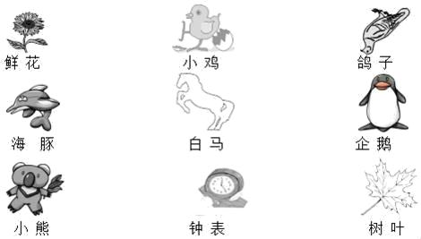

# Mathematics (Grade 3)

**ID**: 042be948
**难度**: medium_hard
**题型**: fill_in_the_blank

## 题目

（1）小鸡在白马的（_____）面，鲜花在白马的（_____）面，鸽子在白马的（_____）面．
（2）小熊在海豚的（_____）面，钟表在海豚的（_____）面，树叶在海豚的（_____）面．
（3）企鹅在小鸡的（_____）面，海豚在小鸡的（_____）面，钟表在小鸡的（_____）面．
（4）钟表在鸽子的（_____）面，钟表在鲜花的（_____）面，（_____）、（_____）在钟表的西北面．
（5）白马在鸽子的（_____）面，在小熊的（_____）面，在鲜花的（_____）面．

## 解答

**答案**: 北, 西北, 东北, 南, 东南, 东南, 东南, 西南, 南, 西南, 东南, 海豚, 鲜花, 西南, 东北, 东南

1. Step1:观察图片，确定小鸡和白马的位置关系，得出小鸡在白马的北面
2. Step2:观察图片，确定鲜花和白马的位置关系，得出鲜花在白马的西北面
3. Step3:观察图片，确定鸽子和白马的位置关系，得出鸽子在白马的东北面
4. Step4:观察图片，确定小熊和海豚的位置关系，得出小熊在海豚的南面
5. Step5:观察图片，确定钟表和海豚的位置关系，得出钟表在海豚的东南面
6. Step6:观察图片，确定树叶和海豚的位置关系，得出树叶在海豚的东南面
7. Step7:观察图片，确定企鹅和小鸡的位置关系，得出企鹅在小鸡的东南面
8. Step8:观察图片，确定海豚和小鸡的位置关系，得出海豚在小鸡的西南面
9. Step9:观察图片，确定钟表和小鸡的位置关系，得出钟表在小鸡的南面
10. Step10:观察图片，确定钟表和鸽子的位置关系，得出钟表在鸽子的西南面
11. Step11:观察图片，确定钟表和鲜花的位置关系，得出钟表在鲜花的东南面
12. Step12:观察图片，确定在钟表西北面的物体为海豚和鲜花
13. Step13:观察图片，确定白马和鸽子的位置关系，得出白马在鸽子的西南面
14. Step14:观察图片，确定白马和小熊的位置关系，得出白马在小熊的东北面
15. Step15:观察图片，确定白马和鲜花的位置关系，得出白马在鲜花的东南面

## 知识点

**知识点**:
  - 

---
