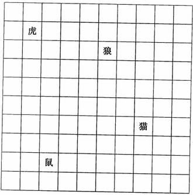

# Mathematics (Grade 3)

**ID**: 09945522
**难度**: medium_hard
**题型**: fill_in_the_blank

## 题目
填空。

1.老虎先向（）平移（）格，再向（）平移（）格能吃到狼。
2.狼先向（）平移（）格，再向（）平移（）格能吃到猫。
3.猫先向（）平移（）格，再向（）平移（）格能吃到鼠。

## 解答

**答案**: 右, 4, 下, 1, 下, 4, 右, 2, 左, 5, 下, 2

1. Step1:观察老虎和狼在图中的位置
2. Step2:确定老虎吃到狼的第一步平移方向为右，数出平移格数为4
3. Step3:确定老虎吃到狼的第二步平移方向为下，数出平移格数为1
4. Step4:观察狼和猫在图中的位置
5. Step5:确定狼吃到猫的第一步平移方向为下，数出平移格数为4
6. Step6:确定狼吃到猫的第二步平移方向为右，数出平移格数为2
7. Step7:观察猫和鼠在图中的位置
8. Step8:确定猫吃到鼠的第一步平移方向为左，数出平移格数为5
9. Step9:确定猫吃到鼠的第二步平移方向为下，数出平移格数为2

## 知识点

**知识点**:
  - 认识平移与旋转现象

---
