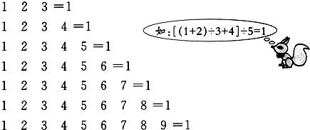

# Mathematics (Grade 3)

**ID**: 0ab93a6c
**难度**: medium_hard
**题型**: fill_in_the_blank

## 题目
添上适当的运算符号，     下面各式结果都得1．试试看

## 解答

**答案**: (1+2)÷3, 1×2+3-4, 1+2-3-4+5, 1×2×3-(4-5)-6, 1×2-3-4+5-6+7, 1+2×3-4+5-6+7-8, 1×(2×3+4+5-6-7+8-9)

1. Step1:对于1 2 3，尝试不同运算组合，得到(1+2)÷3=1
2. Step2:对于1 2 3 4，尝试不同运算组合，得到1×2+3-4=1
3. Step3:对于1 2 3 4 5，尝试不同运算组合，得到1+2-3-4+5=1
4. Step4:对于1 2 3 4 5 6，尝试不同运算组合，得到1×2×3-(4-5)-6=1
5. Step5:对于1 2 3 4 5 6 7，尝试不同运算组合，得到1×2-3-4+5-6+7=1
6. Step6:对于1 2 3 4 5 6 7 8，尝试不同运算组合，得到1+2×3-4+5-6+7-8=1
7. Step7:对于1 2 3 4 5 6 7 8 9，尝试不同运算组合，得到1×(2×3+4+5-6-7+8-9)=1

## 知识点

**知识点**:
  - 填符号组算式．

---
