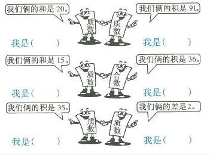

# Mathematics (Grade 3)

**ID**: 0cff1a99
**难度**: medium_hard
**题型**: fill_in_the_blank

## 题目

 我们俩的和是20、我们俩的积是91、质数、质数、我是(    )、我是(    )
 我们俩的和是15、我们俩的积是36、质数、合数、我是(    )、我是(    )
 我们俩的积是35、我们俩的差是2、质数、质数、我是(    )、我是(    )

## 解答

**答案**: 7, 13, 3, 12, 5, 7

1. Step1:对于和是20、积是91的两个质数，从质数中寻找，因为13和7是质数，且13 + 7 = 20，13×7 = 91，所以这两个数是7和13
2. Step2:对于和是15、积是36的一个质数和一个合数，因为3是质数，12是合数，且3 + 12 = 15，3×12 = 36，所以这两个数是3和12
3. Step3:对于积是35、差是2的两个质数，因为5和7是质数，且7×5 = 35，7 - 5 = 2，所以这两个数是5和7

## 知识点

**知识点**:
  - 数与代数;

---
