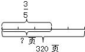

# Mathematics (Grade 3)

**ID**: 13255636
**难度**: medium_hard
**题型**: fill_in_the_blank

## 题目
列式计算：
 
$\underline{\hspace{5em}}$．

## 解答

**答案**: 320×3/5=192(页)

1. Step1:观察图形可知总页数为320页，要求的是总页数的$rac{3}{5}$的页数
2. Step2:根据求一个数的几分之几是多少用乘法计算，所以用总页数320乘$rac{3}{5}$
3. Step3:计算320×$rac{3}{5}$，得到结果为192页

## 知识点

**知识点**:
  - 图文应用题．

---
