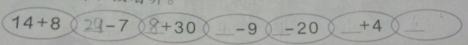

# Mathematics (Grade 3)

**ID**: 14c04188
**难度**: medium_hard
**题型**: fill_in_the_blank

## 题目

 14+8  -7  +30  -9 -20 +4

## 解答

**答案**: 22, 15, 45, 36, 16, 20

1. Step1:计算14+8，结果为22
2. Step2:用22减去7，结果为15
3. Step3:用15加上30，结果为45
4. Step4:用45减去9，结果为36
5. Step5:用36减去20，结果为16
6. Step6:用16加上4，结果为20

## 知识点

**知识点**:
  - 

---
