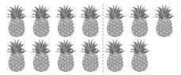

# Mathematics (Grade 3)

**ID**: 171c8f8c
**难度**: medium_hard
**题型**: fill_in_the_blank

## 题目
看图列出一道加法算式和一道减法算式。（kàn tú liè chū yī dào jiā fǎ suàn shì hé yī dào jiǎn fǎ suàn shì 。）

8+□=□
13-□=□

## 解答

**答案**: 8+5=13, 13-5=8

1. Step1:观察图形可知左边有8个菠萝
2. Step2:观察图形可知右边有5个菠萝
3. Step3:根据加法意义，用左边的8个菠萝加上右边的5个菠萝，得到加法算式8+5=13
4. Step4:由前面得到总共13个菠萝，根据加减法互逆关系，用总共的13个菠萝减去右边的5个菠萝，得到减法算式13 - 5 = 8

## 知识点

**知识点**:
  - 看图列式;加法和减法的互逆关系

---
