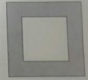

# Mathematics (Grade 3)

**ID**: 1c90bad6
**难度**: medium_hard
**题型**: fill_in_the_blank

## 题目
图中大正方形的边长是m厘米，小正方形的边长是n厘米．
 (1)大正方形的周长是(   )厘米．
 (2)大正方形的面积是(   )平方厘米．
 (3)涂色部分的周长是(   )厘米．
 (4)涂色部分的面积是(   )平方厘米．

## 解答

**答案**: 4m, m**2, 4m+4n, m**2-n**2

1. Step1:根据正方形周长公式C = 4×边长，大正方形边长是m厘米，所以大正方形周长为m×4 = 4m厘米
2. Step2:根据正方形面积公式S = 边长×边长，大正方形边长是m厘米，所以大正方形面积为m×m = m**2平方厘米
3. Step3:因为涂色部分周长等于大正方形周长加上小正方形周长，大正方形周长是4m厘米，小正方形周长是n×4 = 4n厘米，所以涂色部分周长为4m + 4n厘米
4. Step4:因为涂色部分面积等于大正方形面积减去小正方形面积，大正方形面积是m**2平方厘米，小正方形面积是n×n = n**2平方厘米，所以涂色部分面积为m**2 - n**2平方厘米

## 知识点

**知识点**:
  - 

---
