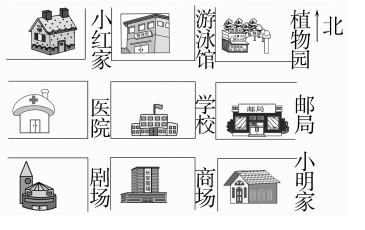

# Mathematics (Grade 3)

**ID**: 1db31cb2
**难度**: medium_hard
**题型**: fill_in_the_blank

## 题目
看图填空。

（1）商场在小明家的（）面。
（2）小红家在学校的（）方向。
（3）学校的东北面是（）。
（4）学校的西南面是（）。

## 解答

**答案**: 西, 西北, 植物园, 剧场

1. Step1:根据'上北下南，左西右东'，以小明家为中心，商场在小明家左边，所以商场在小明家的西面
2. Step2:以学校为中心，小红家在学校的左上方，所以小红家在学校的西北方向
3. Step3:以学校为中心，学校的右上方是植物园，所以学校的东北面是植物园
4. Step4:以学校为中心，学校的左下方是剧场，所以学校的西南面是剧场

## 知识点

**知识点**:
  - 辨认方向

---
