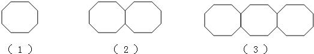

# Mathematics (Grade 3)

**ID**: 1e4adbcf
**难度**: medium_hard
**题型**: fill_in_the_blank

## 题目
(2010•沁水县模拟)用小棒按照如图方式摆图形．

摆第5个图形需要______根小棒，摆第100个图形需要______根小棒．

## 解答

**答案**: 36, 701

1. Step1:分析摆图形规律，摆1个八边形需8根小棒，摆2个八边形需8 + 1×7根小棒，摆3个八边形需8 + 2×7根小棒，总结出摆n个八边形需要8 + (n - 1)×7根小棒
2. Step2:当n = 5时，代入上述规律式子，计算8 + (5 - 1)×7 = 8 + 4×7 = 36根
3. Step3:当n = 100时，代入上述规律式子，计算8 + (100 - 1)×7 = 8 + 99×7 = 701根

## 知识点

**知识点**:
  - 数与形结合的规律．

---
