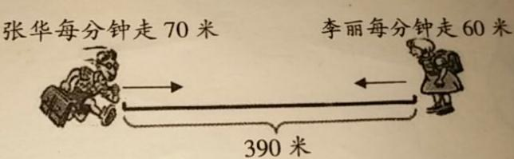

# Mathematics (Grade 3)

**ID**: 1e4c619e
**难度**: medium_hard
**题型**: fill_in_the_blank

## 题目

 张华每分钟走70米      李丽每分钟走60米
 390米
 几分钟后两人相遇？
 (  +  )×(    )=390(米)

## 解答

**答案**: 70, 60, x

1. Step1:根据题目可知张华的速度是每分钟70米，李丽的速度是每分钟60米，所以第一个空应填张华的速度70
2. Step2:第二个空应填李丽的速度60
3. Step3:设x分钟后两人相遇，根据等量关系(张华的速度+李丽的速度)×时间=总路程，可知第三个空应填代表时间的x

## 知识点

**知识点**:
  - --

---
