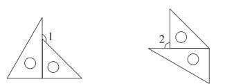

# Mathematics (Grade 3)

**ID**: 2567b99b
**难度**: medium_hard
**题型**: fill_in_the_blank

## 题目
下面两幅图均是由一幅三角尺拼成的，∠1和∠2各是多少度？

## 解答

**答案**: 135°, 90°

1. Step1:明确平角的度数为180°
2. Step2:根据第一幅图中45°的角和∠1组成平角，计算∠1的度数，即∠1 = 180° - 45° = 135°
3. Step3:根据第二幅图中90°的角和∠2组成平角，计算∠2的度数，即∠2 = 180° - 90° = 90°

## 知识点

**知识点**:
  - 角的认识

---
