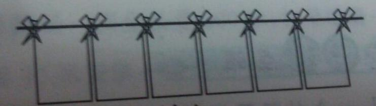

# Mathematics (Grade 3)

**ID**: 25936eb0
**难度**: medium_hard
**题型**: fill_in_the_blank

## 题目
一根绳子上晒了6条毛巾（如图），一共要用多少个夹子？再晒8条，至少要再添加几个同样的夹子？

## 解答

**答案**: 7, 8

1. Step1:根据规律'夹子数=毛巾数+1'，计算晒6条毛巾所需夹子数，即6 + 1 = 7个
2. Step2:考虑再晒8条毛巾时，若和靠边的晒一起省一个夹子，此时至少需要8个夹子

## 知识点

**知识点**:
  - --

---
