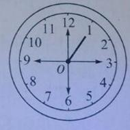

# Mathematics (Grade 3)

**ID**: 25c5e2a8
**难度**: medium_hard
**题型**: fill_in_the_blank

## 题目
看钟表填空。

 （1）指针从“12”绕点0顺时  针旋转（  ）°到“1”。
 （2）指针从“1”绕点O顺时针旋转90°到（  ）。
 （3）指针从“6”绕点O于｜则时针旋转到“9”旋转了 （  ）°。
 （4）指针从“3”绕点0顺时针旋转（ ）°到“12" 。

## 解答

**答案**: 5, 4, 90, 135

1. Step1:钟面一圈为360°，共12个大格，每个大格的角度为360°÷12 = 30°，指针从“12”绕点O顺时针旋转到“1”，经过1个大格，所以旋转了30°，答案为30；
2. Step2:因为每个大格是30°，90°÷30° = 3，指针从“1”绕点O顺时针旋转90°，即旋转3个大格，1 + 3 = 4，所以旋转到4；
3. Step3:指针从“6”绕点O顺时针旋转到“9”，经过9 - 6 = 3个大格，每个大格30°，3×30° = 90°，所以旋转了90°；
4. Step4:指针从“3”绕点O顺时针旋转到“12”，经过12 - 3 = 9个大格，每个大格30°，9×30° = 270°，所以旋转了270°。

## 知识点

**知识点**:
  - 

---
