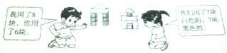

# Mathematics (Grade 3)

**ID**: 29f87742
**难度**: medium_hard
**题型**: fill_in_the_blank

## 题目

一共用了多少块积木？
□○□=□（块）

## 解答

**答案**: 7, ×, 2, 14

1. Step1:分析题目可知，需计算总共用的积木数
2. Step2:由解析可知，一共用去的积木数量等于白色或黑色积木数量的2倍
3. Step3:已知白色或黑色积木数量为7块
4. Step4:根据乘法意义，用白色积木数量7乘以2来计算总积木数
5. Step5:得出计算式子7×2=14，所以答案为7、×、2、14

## 知识点

**知识点**:
  - 整数、小数复合应用题

---
